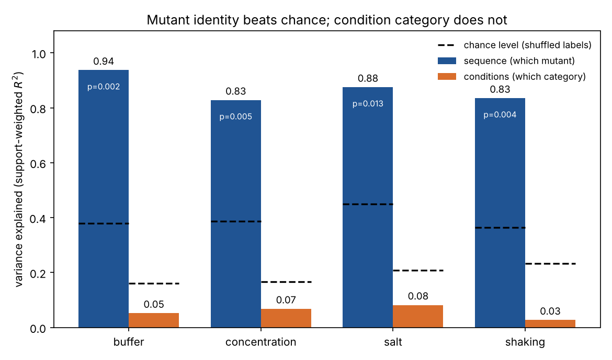
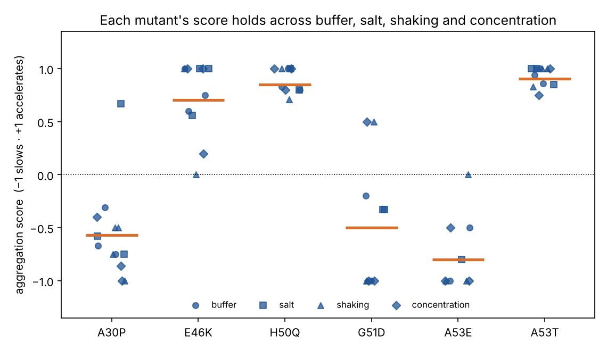
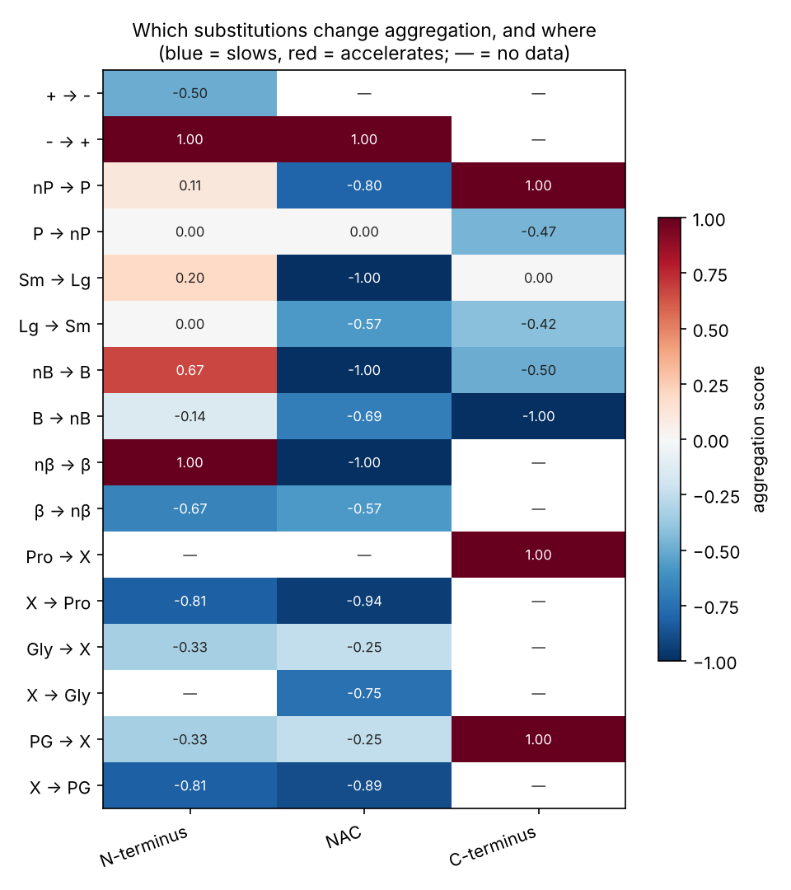
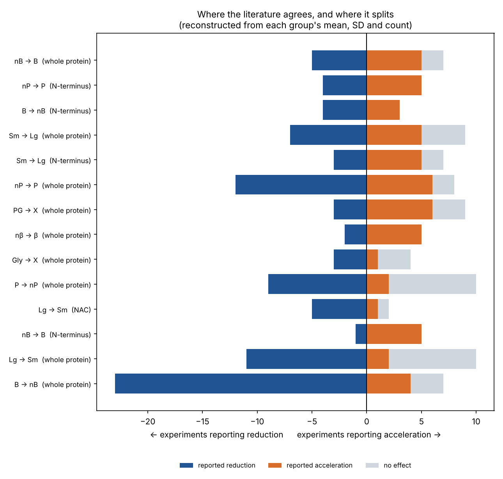

# α-Synuclein aggregation: sequence vs. conditions

**Question:** how much of the variation in reported α-synuclein aggregation
behaviour is explained by the protein's **sequence**, and how much by the
**experimental conditions** each measurement was made under?

Data: the open-access supplementary tables of **Pancoe et al. 2022**
(*J Mol Biol* 434(23):167859, [PMC9922159](https://pmc.ncbi.nlm.nih.gov/articles/PMC9922159)),
whose authors explicitly tabulated these data for computational reuse.
Everything below is extracted from that PDF and verified against it — see
[`SI_FINDINGS.md`](SI_FINDINGS.md) for the full write-up and caveats.

## Results

**1. Sequence explains the score; condition category carries no signal.**
Across the 6 familial mutants, *which mutant* explains 83–94% of the variance
**among condition-category means**, against a shuffled-label chance level of
36–45% (p = 0.002–0.013, uncorrected across 8 tests — 4 dimensions × 2 factors). That figure is an **upper bound**: each point is
already an average of up to 16 experiments, so disagreement inside a cell is
removed before the variance is computed. At the level of individual reported
experiments the same model explains **at least 51–58%**
(`variance_explained_bounds`); the true value lies in between and cannot be
resolved, because S7–S10 report no standard deviations. *Which condition category* explains 3–8%,
against a chance level of 16–23% — i.e. **below chance in every table**. The
chance levels matter: mutant is a 5-df factor on 14–19 cells, so raw R² alone
would overstate the contrast. Each table is tested on its own: the four tables
are four partitions of the *same* experiments, so pooling them would count each
experiment up to four times.



Each mutant's score holds across very different conditions, while the mutants
themselves sit far apart — though the real exceptions are visible and kept
(A30P in low salt flips to +0.67; G51D at medium shaking to +0.50):



**2. The NAC core is where sequence matters.** Support-weighted mean score by
region: **NAC (61–95) −0.57**, C-terminus −0.35, N-terminus −0.10. **Only the
NAC result is robust.** Those means include the ten same-class control rows;
on class-changing substitutions alone the N-terminus and C-terminus are
indistinguishable (−0.19 vs −0.20), and their ordering flips above a support
threshold of 3. The NAC stays clearly lowest either way (−0.57 with controls,
−0.70 without) at every threshold from 1 to 10. Within the
NAC the strongest substitution is **X → Pro (−0.941, n=17)** — the
β-sheet-breaking effect the fibril model predicts, recovered from the data.

The whole-protein figure often quoted for X → Pro (−0.88, n=33) aggregates 16
N-terminal and 17 NAC measurements and **none** from the C-terminus, so it is
not a regional result. Per-region rankings exist (`region_ranking()`) but only
the NAC row is quotable: the N-terminus and C-terminus leaders are the maximum
of 5–7 candidates and both land on exactly ±1.000 with sd = 0 at n = 5 and 7 —
order statistics of a small sample, not effect estimates.



> **The caveat that matters:** the scores are *already WT-normalized within
> each study*, which removes much raw between-lab condition variance by
> construction. So result 1 says conditions add little **once effects are
> expressed against a matched WT control** — which is exactly the authors'
> recommendation, not evidence that raw rates are condition-independent.

**3. How much a mutation matters depends on which mechanism you measure.**
From [Flagmeier et al. 2016](https://pmc.ncbi.nlm.nih.gov/articles/PMC5027465),
same five familial mutants, same lab: their effects span **10,000×** for
lipid-induced nucleation, **100×** for secondary nucleation and only **10×**
for elongation. A single lumped outcome averages that distinction away.

Two mutants also flip sign between the bulk-assay literature and lipid-induced
nucleation — E46K (+0.70 vs −2 log10) and H50Q (+0.85 vs −1). Reported as case studies, not as a rate, and **not as independent
corroboration** — Pancoe cites Flagmeier, so the two sources may share
underlying experiments: at n=4 the split is not distinguishable from chance
(binomial p = 1.0). Method and limits: [`COMPARISON_METHOD.md`](COMPARISON_METHOD.md).

> **Scope limit on results 1 and 2.** Every familial mutant is N-terminal
> (residues 30–53), so the condition analysis is an N-terminus analysis, and
> the NAC and X → Pro findings rest on Pancoe alone — no second source yet
> covers a NAC or C-terminal variant.

**4. The published record is unanimous about proline and deadlocked about bulk.**
Each group's mean, SD and count recover the underlying vote exactly. **No
published experiment reports X → Pro accelerating aggregation** (0 vs 29),
while nB → B splits 5–5 and nP → P splits 5–4. These are counts of *published*
reports: a result matching a strong prior is easier to publish, so unanimity is
consistent with a real effect, selective publication, or both. The
reconstruction doubles as a third extraction check (counts recover as whole
experiments, error < 0.03).



## The data, and how it was verified
The outcome in this SI is a **categorical aggregation score** in {−1, 0, +1}
(reduces / no effect / accelerates), **not** continuous T½. T½ is not tabulated
in this file.

| file | source | rows |
|---|---|---|
| `data/conditions_familial.csv` | Tables S7–S10 (mutant × condition) | 77 |
| `data/type_scores.csv` | Tables S3–S6 (mutation type × region) | 104 |

The PDF's label column is a CID-mapped font with no Unicode table, and **the
numeric glyph offset differs between pages** (S5/S6 vs S7–S10) — a fixed map
silently decodes `1.000` as `20111`. So the ingesters calibrate the offset per
page, read columns positionally, bounds-check every value, and assert 9 values
read off the rendered pages. Drift fails loudly rather than producing plausible
garbage. No value is transcribed by hand into the data.

```bash
make setup                      # pip install -e .[dev]
python -m asyn.ingest_si        # Tables S7–S10  -> conditions_familial.csv
python -m asyn.ingest_types     # Tables S3–S6   -> type_scores.csv
python -m asyn.si_analysis      # the decomposition
python -m asyn.si_report        # the three figures
make test                       # 20 tests
```
`data/raw/SI.pdf` is gitignored; download it from the PMC link above if you
need to re-run extraction.

## Also in here: a validated-prediction scaffold
`asyn.features / splits / decompose / predict` implement the full
leave-one-study-out regression pipeline from the original plan — study-grouped
splits, fold-local preprocessing, nested CV, three baselines, bootstrap CIs, no
neural network. **It needs raw kinetics (T½), which this SI does not contain**,
so it currently runs on a labelled synthetic stand-in (`make all`) and produces
no scientific result. It is kept ready for that data.

## Layout
```
src/asyn/   ingest_si · ingest_types · si_analysis · si_report   (real)
            features · splits · decompose · predict · synth      (T½ scaffold)
data/       conditions_familial.csv · type_scores.csv · data_dictionary.md
reports/figures/  si_fig1..3 (real)
SI_FINDINGS.md · preregistration.md
```
