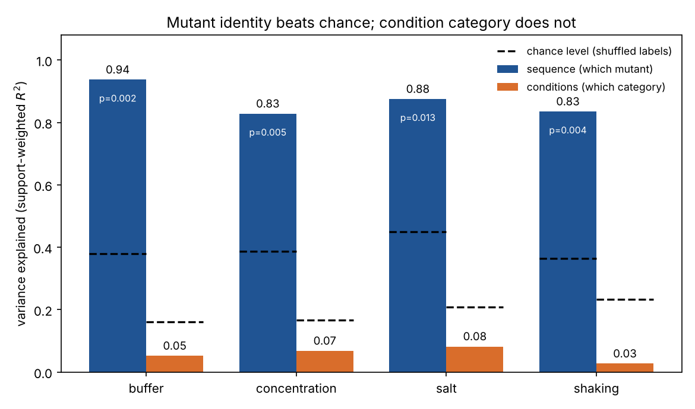
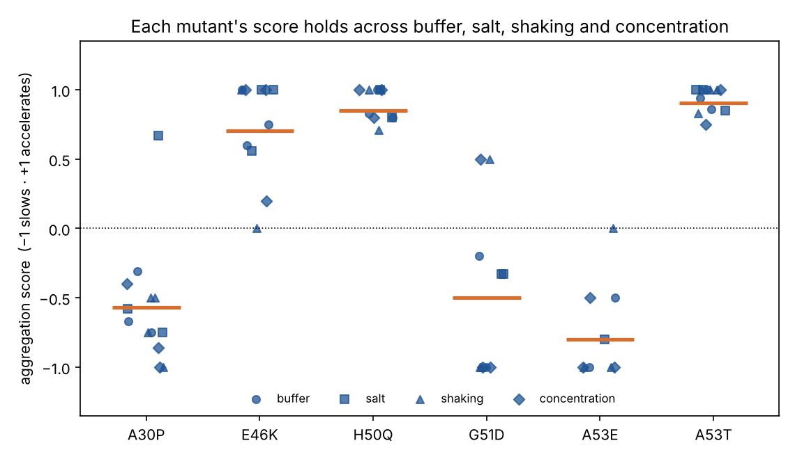
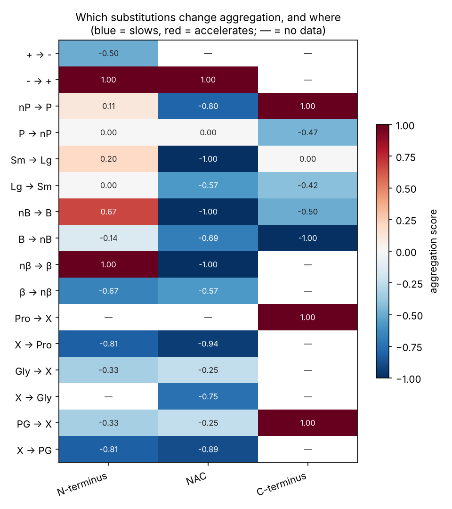

# What the real SI actually contains (and the first real result)

The project plan assumed a 131-row table of single mutants with continuous **T½**
(half-time to max ThT) and full per-row conditions. **That table is not in this
supplementary PDF.** Reading all 12 pages of Pancoe et al. 2022 SI:

- The outcome is a **categorical aggregation score** in {−1, 0, +1} (reduces /
  no effect / accelerates), **normalized to the WT control**. No continuous T½.
- Tables **S3–S6**: scores averaged by mutation *type* and domain.
- Tables **S7–S10**: scores for the 6 familial mutants (A30P, E46K, H50Q, G51D,
  A53E, A53T) × condition category (buffer / salt / shaking / αS concentration),
  each with a support count. **This is the only per-(variant × condition) data
  in the file**, so it is the sequence-vs-conditions dataset.

`data/conditions_familial.csv` (77 rows, 301 underlying measurements) is
extracted from S7–S10 by `asyn.ingest_si` — numbers decoded from the PDF's own
text layer (the font's fixed CID offset), labels read from the rendered tables,
row counts asserted, and 5 values checked against the rendered pages. Real,
verified, no fabrication.

## First real result (`asyn.si_analysis`)
Support-weighted variance explained in the aggregation score:

| dimension | mutant R² | *chance* | p | condition R² | *chance* |
|---|---|---|---|---|---|
| buffer | 0.94 | *0.38* | 0.002 | 0.05 | *0.16* |
| concentration | 0.83 | *0.39* | 0.005 | 0.07 | *0.17* |
| salt | 0.88 | *0.45* | 0.013 | 0.08 | *0.21* |
| shaking | 0.83 | *0.36* | 0.004 | 0.03 | *0.23* |

**Raw R² alone would overstate this, and the chance columns are why.** Mutant
is a 5-degree-of-freedom factor and a condition category has 1–2, on only
14–19 cells, so the larger factor explains more variance mechanically: a
*randomly shuffled* mutant label already reaches R² ≈ 0.4 per dimension. Each
factor is therefore compared against its own permutation null
(`asyn.si_analysis.permutation_test`, 1000 shuffles; `reports/permutation_test.csv`).

One bug had to be fixed before this comparison was fair: `"None"` — a real
category meaning no added salt or no shaking — is in pandas' default NA list,
so those 12 cells were read as missing and silently dropped from the *category*
model while the *mutant* model kept them (58 rows against 66). Since the
quiescent/no-salt levels are where a condition effect should be largest, the
bug favoured the conclusion. Fixed; both models now use all 66 cells, and the
finding holds (salt's condition R² moves 0.14 → 0.08).

Against that baseline the result is cleaner than the raw numbers suggested:
mutant identity beats chance in every table (p = 0.002–0.013),
while **condition category lands *below* its own chance level everywhere**
(0.03–0.08 observed against 0.16–0.23 expected, all p ≥ 0.71). Condition
category carries no detectable signal at all — it does not merely lose to
sequence.

**Why there is no pooled row.** An earlier version reported a pooled result
(R² 0.86 against a 0.10 chance level, p = 0.001). It was invalid. Every
experiment has a buffer *and* a salt *and* a shaking speed *and* a
concentration, so the four tables are four partitions of the **same**
experiments — A30P's buffer cells total 23 measurements and its salt cells total
the same 23. Stacking the tables counted each experiment up to four times (301
summed support against at most 93 in any one table), which is what drove that
pooled chance level down and its p-value to the floor. The four tables are
therefore four consistent views of one dataset, not four independent
replications, and their p-values cannot be combined either.

Within-mutant spread across conditions is **0.20–0.38×** the between-mutant
spread. Plotting every extracted cell makes the same point directly — each
mutant's score holds across very different buffers, salts, shaking speeds and
concentrations, while the mutants themselves sit far apart:

The exceptions are visible and worth keeping: A30P in low salt reads +0.67
against its −0.57 mean, and G51D at medium shaking reads +0.50 against −0.49.
Conditions can flip an individual reading even where they explain little
variance overall. The authors' own example: A30P scores −0.75 in PBS vs −0.31 in Tris,
but averaged PBS→Tris is −0.12 ± 0.31 — no generalizable buffer effect.

**Conclusion (for this dataset): which mutation it is explains the aggregation
score; which condition category it was measured under does not** — the opposite
of the plan's hypothesis that conditions would swamp sequence. A legitimate,
reportable negative result.

## The sequence side (Tables S3–S6)

`asyn.ingest_types` extracts all four mutation-type tables (104 rows, 866
measurements) — same CID decoding, but **S5 and S6 use a different glyph
offset**, so the offset is calibrated per page and every value is bounds-checked
and spot-checked against the rendered pages (9 checks, in the ingester).

Support-weighted mean score by region — mutations in the fibril core slow
aggregation most, mutations in the N-terminus barely matter:

| region | weighted mean score | measurements |
|---|---|---|
| **NAC (61–95)** | **−0.57** | 145 |
| C-terminus | −0.35 | 110 |
| N-terminus | −0.10 | 178 |

Across the whole protein the largest effects (n ≥ 10) are **X → Pro (−0.88,
n=33)** and **X → PG (−0.85, n=34)** — proline blocks aggregation, the
β-sheet-breaking behaviour the fibril model predicts, recovered from the data.

**But those whole-protein rows aggregate across regions and should not be read
as regional results.** X → Pro's 33 measurements split 16 in the N-terminus and
17 in the NAC, with **none in the C-terminus** — so proline substitution is
simply untested there. Ranked within each region (support floor n ≥ 5,
`asyn.si_analysis.strongest_by_region`):

| region | strongest substitution | score | sd | n |
|---|---|---|---|---|
| N-terminus | nβ → β | **+1.000** | 0.000 | 5 |
| NAC | X → Pro | **−0.941** | 0.235 | 17 |
| C-terminus | B → nB | **−1.000** | 0.000 | 7 |

The regional view carries information the aggregate loses: **the N-terminus's
strongest effect accelerates aggregation, while the NAC's and C-terminus's
block it.** Averaging over regions partly cancels those opposing signs.

Two cautions on reading that table. The N-terminus and C-terminus winners rest
on n=5 and n=7 with sd = 0 — unanimous, but small; X → Pro in the NAC is the
only one resting on substantial support. And in the N-terminus X → PG is
numerically identical to X → Pro (−0.813, n=16) because every PG substitution
there is a proline one — X → Gly has no N-terminal measurements. Per-region
rankings: `asyn.si_analysis.region_ranking`.

### The essential caveat
The scores are **already WT-normalized within each study**, which removes much
of the raw between-lab condition variance *by construction*. So this result
says conditions add little **once effects are expressed relative to a matched WT
control** — which is exactly the authors' recommendation. Testing whether raw,
un-normalized aggregation rates are condition-dominated needs the raw kinetics
(T½), which this SI does not provide. The continuous-T½ regression scaffold
(`asyn.features/splits/decompose/predict`) is kept ready for that data.
